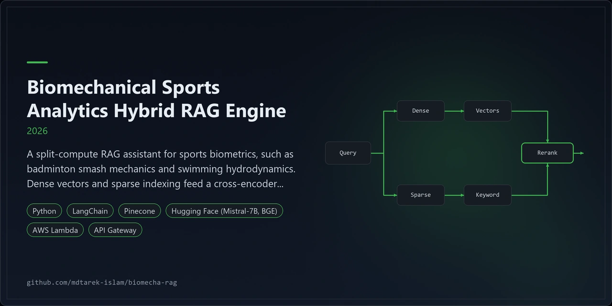
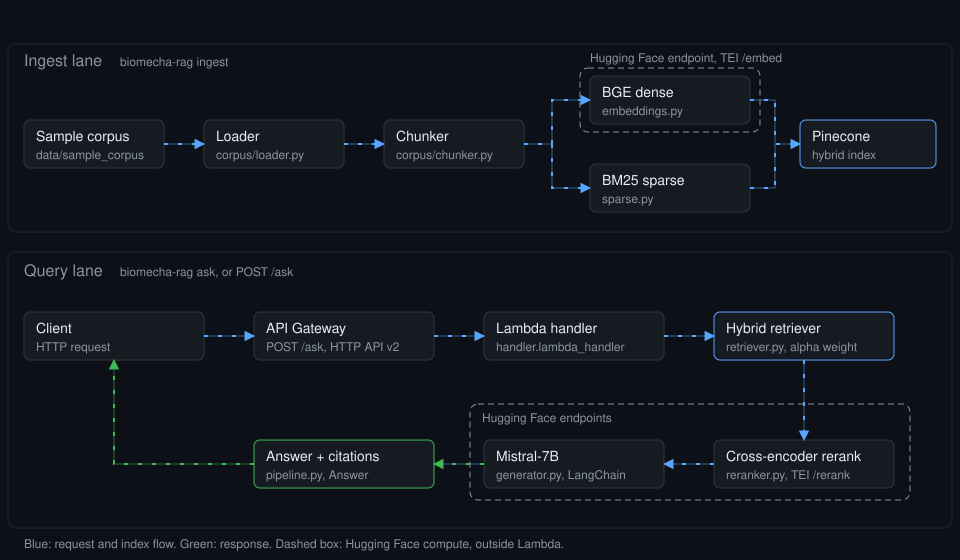
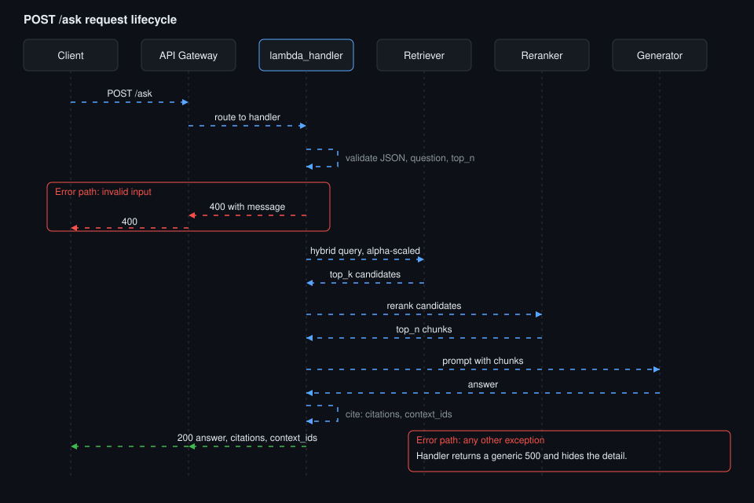

<p align="center"></p>

# Biomechanical Sports Analytics Hybrid RAG Engine

A hybrid RAG assistant for sports biomechanics, split across AWS Lambda and Hugging Face endpoints.

## Overview

A split-compute RAG assistant for sports biometrics, such as badminton smash mechanics and swimming hydrodynamics. Dense vectors and sparse indexing feed a cross-encoder reranker before generation.

AWS Lambda orchestrates each request. The embedding, reranking and generation models run on Hugging Face endpoints. Offline fallbacks let the CLI and the tests run with no credentials. No retrieval quality metrics exist yet.

| Layer | Technology |
|---|---|
| Language | Python 3.11 or later |
| Dense embeddings | BGE on a Hugging Face endpoint (TEI `/embed`) |
| Sparse retrieval | BM25 via `rank-bm25` |
| Vector store | Pinecone hybrid index, dotproduct metric |
| Reranking | Cross-encoder on a Hugging Face endpoint (TEI `/rerank`) |
| Generation | Mistral-7B through LangChain `HuggingFaceEndpoint` |
| Serving | AWS Lambda, API Gateway HTTP API v2 |
| Infrastructure | Terraform |
| CI | GitHub Actions: ruff, pytest, terraform fmt and validate |

## Architecture



1. Ingest: `corpus/loader.py` reads the notes and `corpus/chunker.py` splits them into overlapping word windows.
2. Encode: BGE produces dense vectors on a Hugging Face endpoint. `sparse.py` fits BM25 locally and writes `bm25_params.json`.
3. Index: both vectors go into one Pinecone index with the dotproduct metric.
4. Request: API Gateway routes `POST /ask` to `biomecha_rag.handler.lambda_handler`.
5. Retrieve: the hybrid retriever scales the dense query by alpha and the sparse query by 1 minus alpha.
6. Rerank: a cross-encoder on a Hugging Face endpoint reorders the candidates.
7. Generate: Mistral-7B answers from the top chunks. The response carries the answer, citations and context IDs.



The second view traces one `POST /ask` call through validation, hybrid retrieval, reranking, generation and citation, with the 400 and 500 error paths.

Design decisions are in three ADRs:

- [ADR 0001: split compute between Lambda and Hugging Face endpoints](./docs/adr/0001-split-compute.md)
- [ADR 0002: hybrid scoring by scaled dot product](./docs/adr/0002-hybrid-scoring.md)
- [ADR 0003: deterministic offline fallbacks behind each interface](./docs/adr/0003-offline-fallbacks.md)

## Features

- Hybrid retrieval: BGE dense vectors plus BM25 sparse vectors, weighted by `HYBRID_ALPHA`.
- Cross-encoder reranking before generation.
- Mistral-7B generation through LangChain, with citations limited to retrieved chunks.
- Lambda handler for `POST /ask` that returns `{answer, citations, context_ids}`.
- Terraform for the Lambda function, IAM, log group, HTTP API and SSM parameter names.
- Offline mode: hashing embedder, lexical reranker, in-memory hybrid store and extractive generator.
- Secrets read from SSM Parameter Store by name, so no secret sits in Terraform state or the package.

### Engineering findings

- Tests: 57 passed, 1 skipped. The skipped test needs the `pinecone` package, which was absent.
- The sample corpus holds 4 illustrative notes: badminton smash, swimming hydrodynamics, sprint start and jump landing. They carry no citations and no data.
- The offline fallbacks show wiring, not answer quality. Their scores say nothing about BGE or Mistral-7B accuracy (ADR 0003).
- No retrieval quality metrics exist.
- Not verified against real services: Hugging Face endpoints, Pinecone and SSM.
- Not run: `terraform validate` and `ruff`. CI defines both.
- Lambda zip packaging is unverified. No build script exists yet. `langchain-huggingface` risks the 250 MB unzipped limit.
- Endpoint cold starts can exceed the 30 second HTTP API limit (ADR 0001).
- Adding documents means refitting BM25 and re-upserting (ADR 0002).

## Quick start

Requires Python 3.11 or later.

```bash
git clone https://github.com/mdtarek-islam/biomecha-rag.git
cd biomecha-rag
python -m venv .venv
source .venv/bin/activate        # Windows: .venv\Scripts\activate
pip install -r requirements-dev.txt
pip install -e .
pytest -q
biomecha-rag ask "How does trunk rotation affect smash speed?" --local
```

The last command runs offline over `data/sample_corpus`. It needs no endpoint or key.

## Configuration

`Settings.from_env` in `src/biomecha_rag/config.py` reads these variables. Local `--local` mode needs none.

| Variable | Default | Purpose |
|---|---|---|
| `HF_TOKEN` | empty | Hugging Face token. Alternative: `HF_TOKEN_SSM_PARAM`, an SSM parameter name. |
| `PINECONE_API_KEY` | empty | Pinecone key. Alternative: `PINECONE_API_KEY_SSM_PARAM`. |
| `EMBED_ENDPOINT_URL` | empty | BGE endpoint (TEI `/embed`). |
| `RERANK_ENDPOINT_URL` | empty | Cross-encoder endpoint (TEI `/rerank`). |
| `LLM_ENDPOINT_URL` | empty | Mistral-7B endpoint. |
| `PINECONE_INDEX` | `biomecha-rag` | Index name. |
| `PINECONE_NAMESPACE` | `sports-science` | Namespace. |
| `BM25_PARAMS_PATH` | `bm25_params.json` | Fitted BM25 table. |
| `HYBRID_ALPHA` | `0.5` | Dense weight, 0 to 1. |
| `RETRIEVE_TOP_K` | `20` | Candidates fetched from the index. |
| `RERANK_TOP_N` | `5` | Chunks kept after reranking. |
| `MAX_NEW_TOKENS` | `512` | Generation limit. |
| `TEMPERATURE` | `0.1` | Sampling temperature. |

The repo includes an example environment file with the variable names.

## Usage

Ingest the sample corpus. `--dry-run` fits BM25 and counts chunks without calling any endpoint.

```bash
biomecha-rag ingest --dry-run
biomecha-rag ingest --corpus data/sample_corpus --bm25-out bm25_params.json
```

Ask a question offline, or against the configured endpoints:

```bash
biomecha-rag ask "How does trunk rotation affect smash speed?" --local
biomecha-rag ask "What limits stroke efficiency in freestyle?" --top-n 3
```

Call the deployed API. The handler returns 400 for bad JSON, a missing `question` or an invalid `top_n`, and a generic 500 otherwise.

```bash
curl -X POST "$API_URL/ask" -H "content-type: application/json" \
  -d '{"question": "How does landing stiffness change knee load?", "top_n": 3}'
```

Response shape: `{"answer": "...", "citations": [...], "context_ids": [...]}`.

## Licence and contribution

MIT. See [LICENSE](./LICENSE). Raise bugs and requests as GitHub issues on this repository.

### Branches

- `main` holds production code and the maintenance, security and CI office.
- `generator` holds the research and build office.
- Code moves to `main` only through the merge-to-main command.

CI runs from `.github/workflows/ci.yml` on pushes and pull requests to `main`. It runs:

- Secret scan: gitleaks and a regex fallback.
- Dependency audit with pip-audit and a bandit security scan.
- Quality: ruff, mypy and pytest.
- Governance audit.
- Terraform: fmt check and validate.

Repository governance: the audit step checks `CLAUDE.md` and the `.claude/` folder.

## Maintenance status

Experimental. The code and offline tests exist, but no real endpoint, Pinecone index or deployment has been exercised, and the repo is on upload hold.
